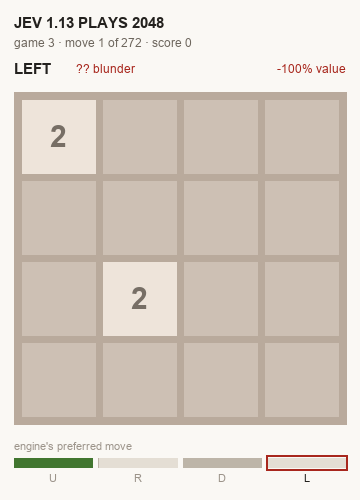
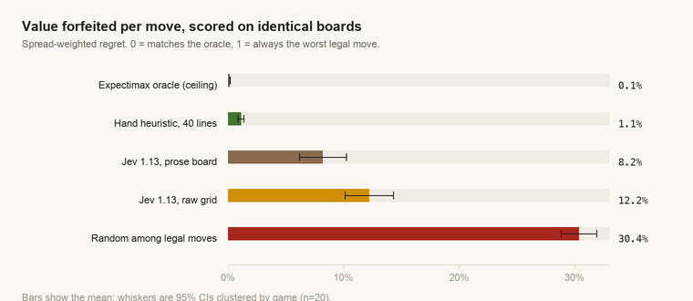
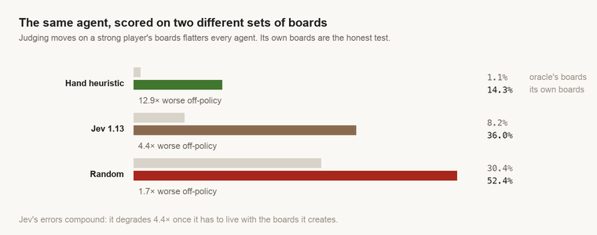
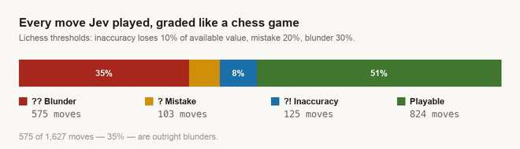
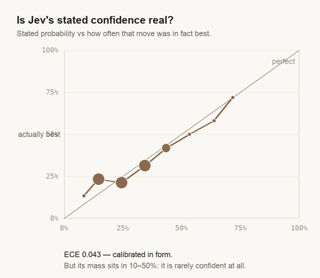
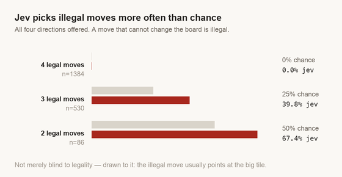

# Can Jev play 2048?

A weekend test of [Jev](https://typesafe.ai/blog/introducing-system-one-models-and-jev). The idea was simple and a bit silly: 2048 is a four-way decision, Jev makes four-way
decisions, so point one at the other and see what happens.

It was fun. It also went somewhere more interesting than "did it win."



*Game 3. Jev picks every move; the bars underneath are the engine's valuation of all four. It
reached the 256 tile in 272 moves and blundered on 41% of them.*

**[▶ Step through all ten games move by move](https://ameya690.github.io/jev-2048/)** —
an analysis board with engine lines, move annotations and an eval curve.

---

## The question had to change first

"Can Jev solve 2048" is close to a category error. 2048 rewards lookahead — that's why expectimax
solves it reliably — and Jev is explicitly a *System One* model: one fast judgement from the current
state, no search. Point a no-search model at a search problem and it loses, and you learn nothing,
because you can't separate "bad classifier" from "wrong tool."

Worse, the obvious metric lies. Measured on 9,193 positions, a 40-line hand-written heuristic agrees
with the engine's top move only **44%** of the time — and still captures **98.9%** of the available
value, because the moves it disagrees on are near-ties that cost nothing. Grading on agreement would
have called that heuristic mediocre. It's near-optimal.

So the question became: **how much of the available value does Jev forfeit per decision, and does
that compound?** 2048 is a good instrument for it, because the correct answer is exactly computable.
Calibration claims are usually unfalsifiable in production. Here there's an oracle.

## Setup

| | |
|---|---|
| **Oracle** | depth-5 expectimax ([andyqueyl/expectimax-2048](https://github.com/andyqueyl/expectimax-2048)), which already returns per-move expected values |
| **Metric** | spread-weighted regret: total value forfeited ÷ total value available |
| **Baselines** | random-among-legal, and a no-search heuristic (monotonicity + smoothness + empty cells) |
| **Positions** | 9,193 sampled from 20 oracle-driven games, plus 10 games Jev played itself |
| **Stats** | games are the cluster, not positions; common random seeds so every arm sees identical boards |
| **Cost** | ~24,000 calls, **$0.53** |

Two metric choices did real work. **Regret, not accuracy** — accuracy weights a near-tied board the
same as a decisive one, which is backwards. And **spread-weighted, not per-position** — normalising
each position by its own spread needs an arbitrary floor, and a sensitivity sweep showed that floor
swings the headline 5×. Summing numerator and denominator removes the knob entirely.

## Results

### 1. Jev lands between random and a 40-line heuristic



The ceiling isn't zero: two reasonable expectimax configurations disagree on a quarter of all
positions while forfeiting 0.15% of value. That's the bar, and Jev is ~55× above it.

Board encoding mattered more than expected. The first run fed Jev a raw 4×4 numeric grid; describing
the same board in sentences cut regret by a third (12.2% → 8.2%). Adding derived features on top —
empty count, max-tile corner, row monotonicity — bought **nothing** beyond the prose itself.

### 2. The number that actually matters



Scoring an agent on boards a *strong player* built flatters it. On the oracle's boards Jev forfeits
8.2% per move; on the boards it creates itself, **36.1%**. Every agent degrades off-policy — the
heuristic degrades more in ratio terms — but where they land is what counts: **14% vs 36% vs 52%**.

In its own games Jev reached a median of 165 moves and the 256 tile. The heuristic reaches 512 in
511 moves. The oracle reaches 8192 in roughly 5,000. And with ten games, Jev's interval
[23.6–48.6] still overlaps random's [40.9–63.9]: clearly worse than hand-written scoring, and **not
cleanly separable from chance**.

### 3. Graded like a chess game



Lichess classifies a chess move by how much winning chance it throws away — inaccuracy at ≥10%,
mistake ≥20%, blunder ≥30%. That is exactly what normalised regret measures, so the thresholds
transfer without distortion.

### 4. Calibrated, but not informative



ECE of 0.043 looks respectable. The Brier decomposition says otherwise:

| predictor | Brier (lower is better) |
|---|---|
| Jev's distribution | 0.7047 |
| uniform over legal moves | 0.7135 |
| **Jev's ranking, magnitudes replaced by empirical rank frequencies** | **0.6978** |

**The magnitudes carry no information beyond their ordering — they're 1.0% worse than discarding
them.** Bootstrapping over whole games, Jev's distribution is *not distinguishable from uniform*
(−0.0088, 95% CI [−0.0192, +0.0012]). The good ECE is an artifact of Jev rarely being confident: its
probability mass sits in 10–50%, and staying calibrated while always saying "unsure" is easy.

Practical consequence: **don't threshold on this confidence.** "Auto-approve when confidence > 0.8"
has almost no support here.

### 5. It doesn't know which moves are legal



Offered all four directions, Jev picks an illegal one **more often than chance would**. Not merely
blind to legality — drawn to it. The hypothesis was that illegal moves point toward where tiles are
already packed, usually the corner holding the big tile. That's testable, and it holds: Jev's
illegal picks point at the max tile 84.8% of the time against a 74.1% control for all illegal
options available.

**Prose encoding fixed move quality by a third and fixed legality by nothing** (13.5% → 14.1%).
Those are separate faculties.

## Conclusion

Jev beats random on move quality and loses decisively to forty lines of hand-written scoring. But
the transferable result isn't the scoreline — it's the dissociation:

> **Better-presented information improves Jev's judgement. It does not improve Jev's grasp of what
> the options are.**

A System One model is a classifier over options you have already computed. The harness owns action
validity; the model owns preference among valid actions. Masking illegal moves made Jev look far
better than it is, because masking was silently doing the mechanical reasoning for it.

For a routing or tagging decision where the option set is known and enumerated, none of this is
disqualifying. For anything that has to reason about what's *possible* from a state — or that wants
to threshold on confidence — this is the shape of the failure.

## What I got wrong

Worth recording, since the corrections changed the numbers:

- **Set the kill criterion too low.** "Beat random" passed, and passing it was uninformative. The
  heuristic was always the real bar.
- **Picked the wrong board encoding** and ran the whole first pass on it, costing Jev a third of its
  regret.
- **Cancelled the most interesting arm.** Jev never played a game until someone asked to watch one —
  and self-play is where the 4.4× degradation showed up.
- **Overstated a ranking quirk.** Jev's 4th choice beating its 2nd didn't survive clustering; only
  the 3rd did.

## Reproduce

```bash
python3 scripts/validate_engine.py      # Python & JS must agree on legality
python3 scripts/gen_positions.py 20 10  # oracle rollout
python3 scripts/self_agreement.py       # the ceiling — no Jev needed
python3 scripts/run_arm1.py --mock random   # must FAIL the kill criterion
python3 scripts/run_arm1.py             # needs an API key
python3 scripts/play_jev.py 10          # let Jev drive
```

Needs `node` and Python 3.9+. Everything up to the ceiling runs with no API key and no third-party
Python packages. Set `OPENROUTER_API_KEY` or `TYPESAFE_API_KEY` (or drop one in
`~/.config/openrouter_key`) for the arms that call Jev. Raw responses are in `data/` so the analysis
can be re-cut without re-calling.

The replay page is `docs/index.html`, rebuilt with
`python3 scripts/build_site.py <source>`; GitHub Pages serves it from `/docs`.

See [MEMO.md](MEMO.md) for the decision memo, with the kill criterion dated before any measurement.

---

*Oracle vendored from [andyqueyl/expectimax-2048](https://github.com/andyqueyl/expectimax-2048).
Move-quality thresholds follow [Lichess](https://lichess.org) convention.*
